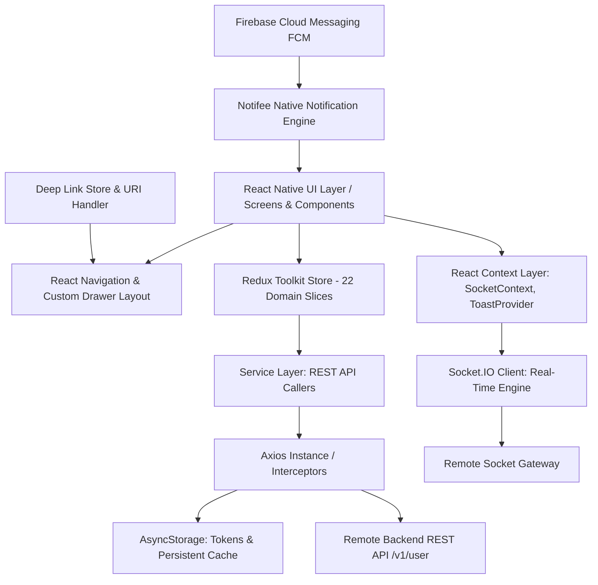
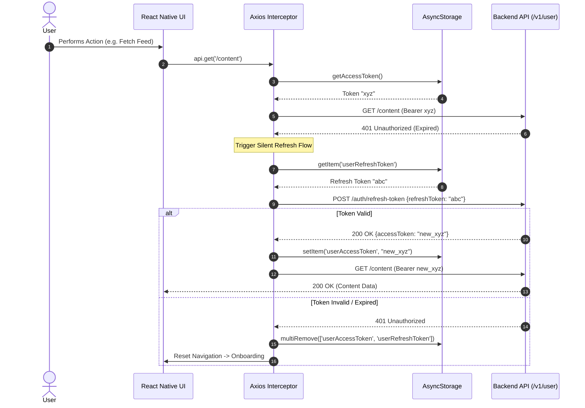

# System Architecture & Technical Design

This document details the architectural foundation, data flow pipelines, state management lifecycle, networking, real-time protocols, and security models of **TheScriptCraft Mobile Application**.

---

## 🏛️ High-Level Architecture

TheScriptCraft client application follows a reactive, layered architecture:

---

## 🔐 Authentication & Session Lifecycle

The app uses JWT (JSON Web Tokens) with a resilient double-token pattern (Access Token + Refresh Token) stored in `@react-native-async-storage/async-storage`.

### 1. Base URL Resolution & Fallbacks
The network instance in `Instance/Instance.tsx` resolves the API URL with runtime fallbacks:
- Primary: `Config.API_BASE_URL` (from `.env` via `react-native-config`).
- Fallback: `DEFAULT_API_BASE_URL` (`https://betatscapi.thescriptcraft.com/v1/user`).
- This safeguards Release builds against R8/ProGuard stripping or empty configuration values.

### 2. Token Injection
Every outgoing HTTP request via `Instance/Instance.tsx` passes through the Axios Request Interceptor:
- Reads `userAccessToken` from `AsyncStorage`.
- Attaches the header: `Authorization: Bearer <userAccessToken>`.

### 3. Automatic Silent Token Refresh
When any API endpoint returns HTTP `401 Unauthorized`:
1. The Axios Response Interceptor catches the error.
2. Checks if `originalRequest._retry` is already set. If not, marks `_retry = true`.
3. Reads `userRefreshToken` from `AsyncStorage`.
4. Makes a dedicated POST request to `/auth/refresh-token` using a distinct `refreshApi` instance (to avoid recursive interceptor loops).
5. If successful:
   - Stores the new `userAccessToken` (and updated `userRefreshToken` if provided).
   - Updates the failed request's headers with the new token.
   - Retries the initial request seamlessly.
6. If refresh fails (or returns 401):
   - Clears `userAccessToken` and `userRefreshToken`.
   - Dispatches a navigation reset to the `Onboarding` screen via `navigationRef`.

---

## ⚡ Real-Time Engine (Socket.IO Architecture)

The real-time layer is managed globally by `SocketProvider` (`src/context/SocketContext.tsx`).

### Initialization & Lifecycle
- When a user logs in and Redux holds `state.auth.user.id`, `SocketProvider` initializes a singleton Socket instance connected to `Config.SOCKET_URL`.
- Transports: `['websocket', 'polling']` with infinite auto-reconnection (`reconnectionAttempts: Infinity`).
- Upon connection: Emits `'join', String(userId)` to subscribe to the user's private notification and direct messaging channel.

### Active Event Subscriptions

| Event Name | Direction | Payload | Description |
| :--- | :--- | :--- | :--- |
| `join` | Client ➔ Server | `userId: string` | Joins private user room on gateway |
| `new_message` | Server ➔ Client | `MessageObject` | Normalizes message and dispatches `chat/addMessage` + updates chat list |
| `new_message` | Client ➔ Server | `{ receiver_id, message, file }` | Sends a direct message to a user |
| `user_status` | Server ➔ Client | `{ user_id, is_online }` | Tracks live presence of peers in `onlineUsers` Set |
| `typing` | Server ➔ Client | `{ chat_id, sender_id }` | Updates typing state map (cleared automatically after 2s timeout) |
| `stop_typing` | Server ➔ Client | `{ chat_id, sender_id }` | Clears active typing status immediately |
| `messages_seen`| Server ➔ Client | `{ chat_id, user_id }` | Dispatches `chat/markMessagesSeen` to update blue ticks |
| `message_edited`| Server ➔ Client | `{ message_id, message }`| Dispatches `chat/editLocalMessage` to reflect edits |
| `message_deleted`| Server ➔ Client | `{ message_id }` | Dispatches `chat/deleteLocalMessage` to remove message from room |
| `notification` | Server ➔ Client | `NotificationObject` | Increments in-app badge count and dispatches `notification/addNotification` |

---

## 🔔 Push Notification Pipeline (FCM + Notifee)

Push notifications are orchestrated through `src/services/notificationService.ts`:

1. **Permission Request**:
   - iOS: `messaging().requestPermission()` checks for authorized/provisional status.
   - Android (API 33+): `PermissionsAndroid.request(POST_NOTIFICATIONS)`.
2. **Channel Setup**:
   - Android requires a high-importance notification channel. `createNotificationChannel()` registers the `default` channel with `AndroidImportance.HIGH`.
3. **FCM Token Registration**:
   - Obtains the device token via `messaging().getToken()`.
   - Transmits the token to the backend via `POST /auth/fcm-token`.
   - Subscribes to `messaging().onTokenRefresh()` to ensure persistent synchronization.
4. **Foreground & Background Notification Delivery**:
   - **Foreground**: Intercepted by `messaging().onMessage()` and rendered visually via `notifee.displayNotification()`.
   - **Background / Quit State**: Intercepted by `messaging().onNotificationOpenedApp()` and `messaging().getInitialNotification()`.

---

## 🌐 Deep Linking & URL Resolution

Deep links are processed through `src/utils/handleDeepLink.ts`. Supported schemes and domains:
- Custom Protocol: `tsc://`
- Universal Links: `https://thescriptcraft.com/` and `https://www.thescriptcraft.com/`

### Resolution Matrix:
- `.../{username}/status/{postId}` ➔ `SinglePostDetailes` (`{ postId }`)
- `.../book/{id}` or `.../books/{id}` ➔ `BookDetails` (`{ bookId }`)
- `.../movie/{id}` or `.../movies/{id}` ➔ `SingleMovieDetails` (`{ id }`)
- `.../contest/{id}` or `.../contests/{id}` ➔ `ContestDetails` (`{ id }`)
- `.../synopsis/{id}` or `.../synopses/{id}` ➔ `SynopsisDetails` (`{ synopsisId }`)
- `.../vision/{id}` or `.../visionx/{id}` ➔ `VisionXDetails` (`{ visionxId }`)
- `.../opportunity/{id}` ➔ `SingleOpportunityDetails` (`{ id }`)
- `.../profile/{identifier}` ➔ `Profile` (UUID regex routes by `id`, string routes by `username`)

---

## 🔄 App Update & Force Upgrade Workflow

Managed via `src/services/updateService.ts` and `src/components/Modals/UpdateModal.tsx`:

1. On app boot, `checkAppUpdate()` compares the installed version (retrieved via `react-native-version-check`) with backend metadata or store listings.
2. If `needsUpdate === true`:
   - An overlay `UpdateModal` appears displaying the latest version and release notes.
   - If `isForceUpdate === true`, dismiss actions are disabled.
   - Clicking **Update** invokes `redirectToStore()`, opening the Google Play Store or Apple App Store URL.

---

© **TheScriptCraft**. All rights reserved.
